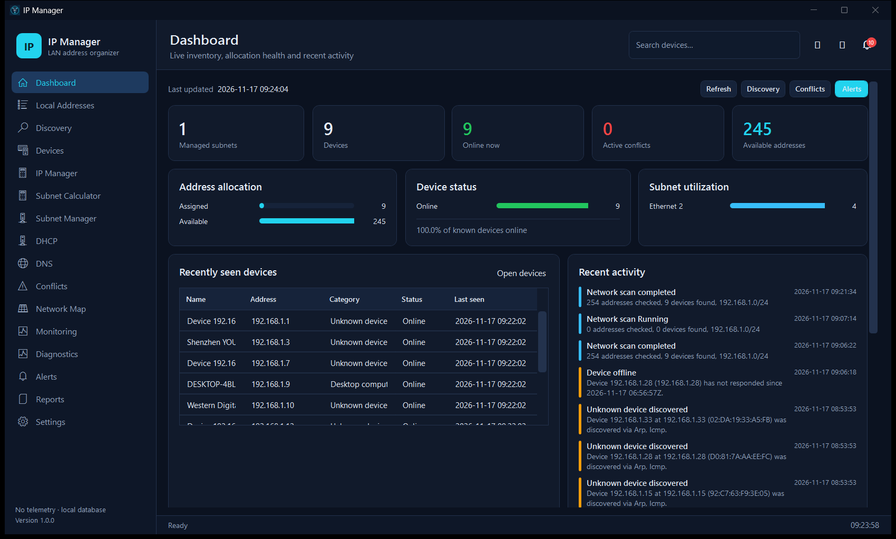
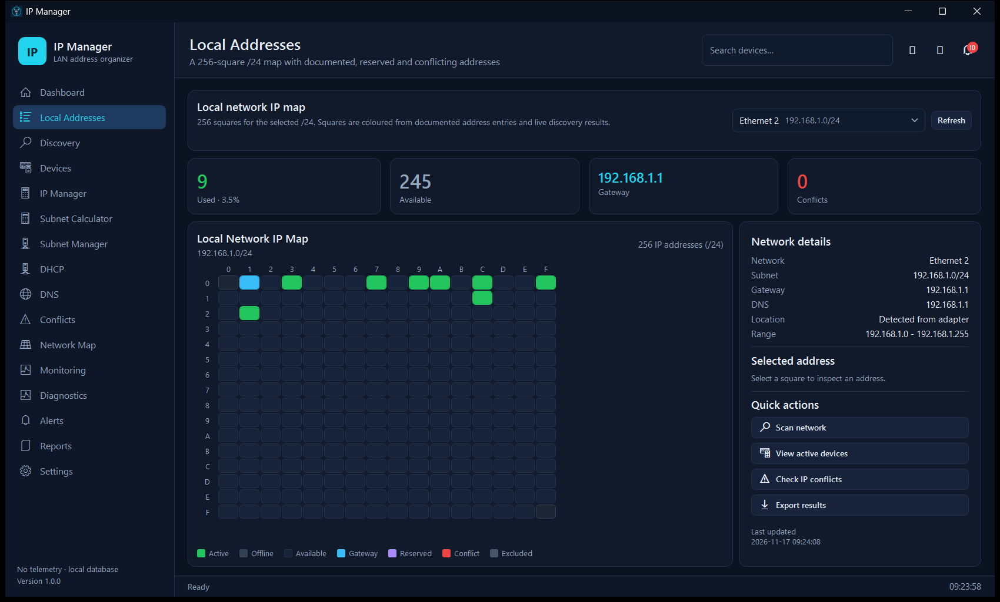
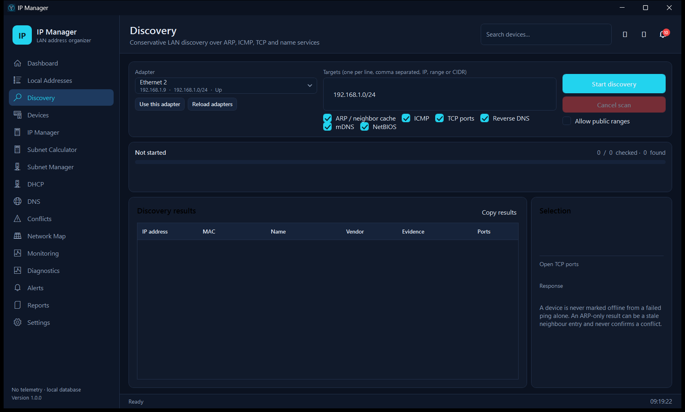
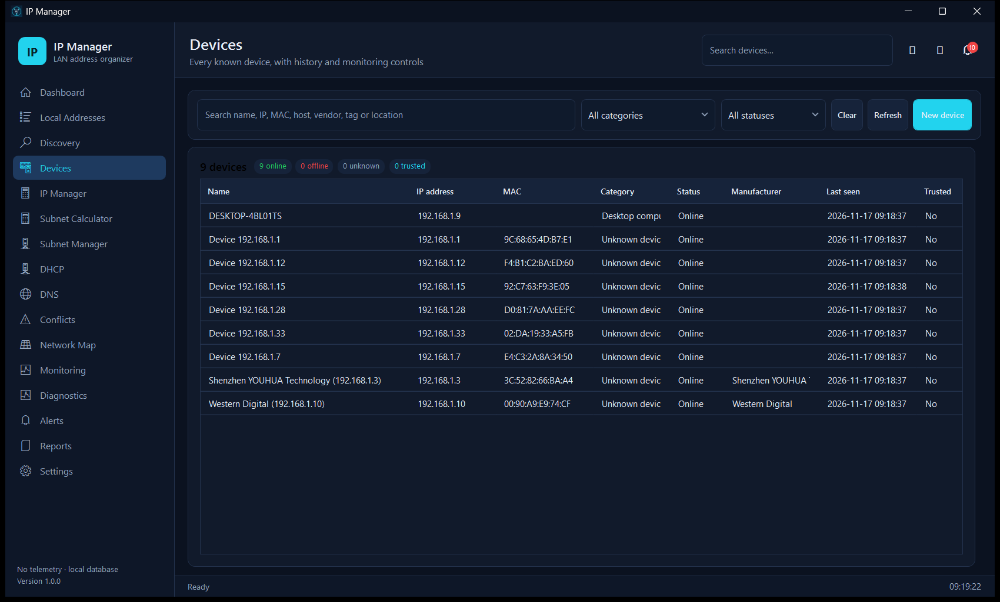
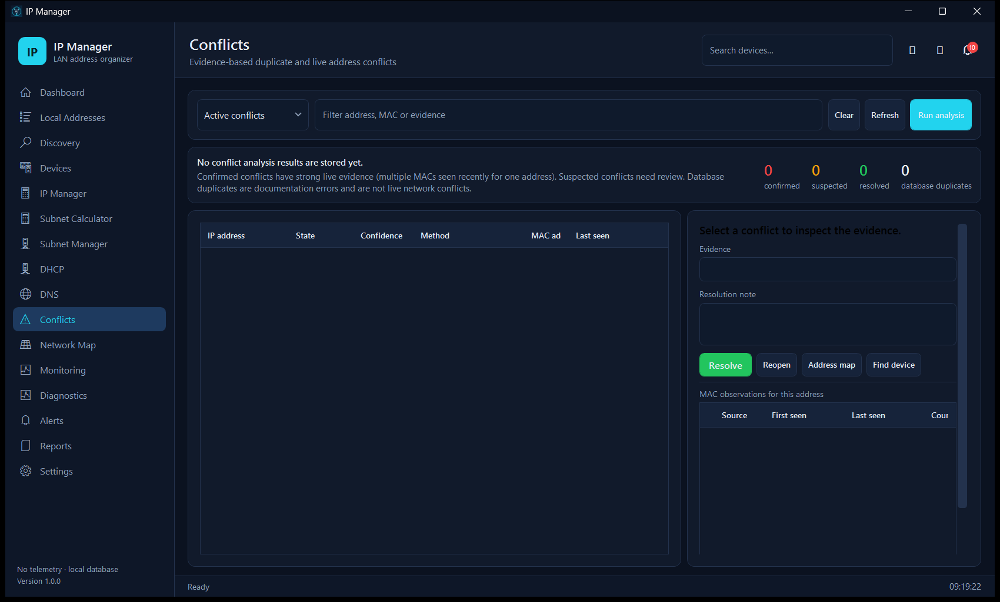
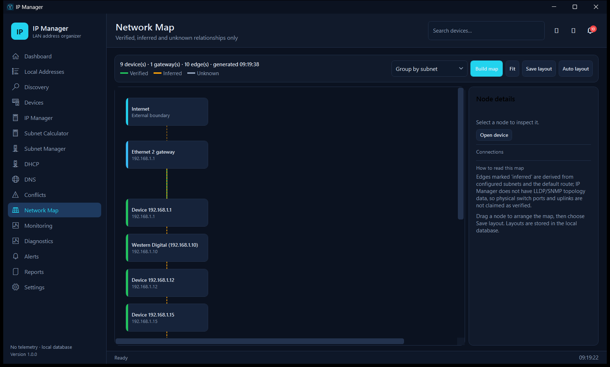
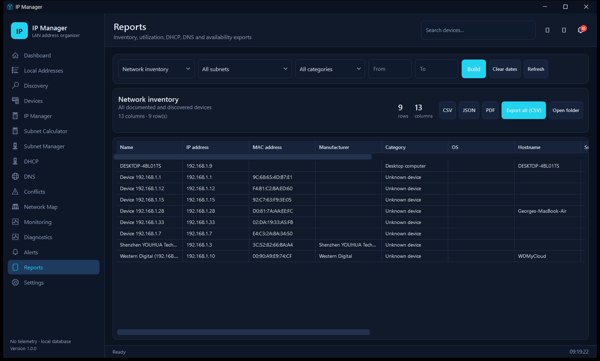

# IP Manager

**A local-first Windows LAN address manager: document the subnet, discover what is really there, and keep the two honest.**

IP Manager is a self-contained WPF desktop application for Windows 10/11 x64. It combines an IP address book, conservative LAN discovery, evidence-based conflict analysis, DHCP/DNS documentation, availability monitoring, a `/24` address map, and reports. It uses real network data only: there is no demo mode, no seeded fake inventory, and no simulated discovery.

<p align="center">
  
  
</p>

## Download

| Build | File | Notes |
|---|---|---|
| Installer (recommended) | [IPManager-Setup-x64.exe](https://github.com/unupunct/IP-Manager/releases/latest/download/IPManager-Setup-x64.exe) | Per-user install, no administrator prompt, Start Menu and desktop shortcuts |
| Portable | [IPManager-Portable-x64.zip](https://github.com/unupunct/IP-Manager/releases/latest/download/IPManager-Portable-x64.zip) | Extract and run `IPManager.exe`; data stays in the `data` folder |
| MSI | [IPManager-Setup-x64.msi](https://github.com/unupunct/IP-Manager/releases/latest/download/IPManager-Setup-x64.msi) | Advanced/managed deployment; the EXE bundle is the normal choice |
| Checksums | [checksums.txt](https://github.com/unupunct/IP-Manager/releases/latest/download/checksums.txt) | SHA-256 for every release asset |

> **Unsigned build:** the binaries are not code-signed because no Authenticode certificate is available. Windows SmartScreen may show "Unknown publisher". Verify the SHA-256 checksum before running the installer. The application itself does not download or execute code.

## About

Most home and small-office networks are documented in someone's memory, a spreadsheet, or not at all. IP Manager keeps an address book and compares it with what the network actually answers. It is deliberately conservative:

- It scans private LAN ranges by default. Public or third-party ranges require an explicit confirmation.
- It never treats "ping failed" as proof that an address is free or that a device is offline.
- It keeps documentation duplicates (two records for one address) separate from live network conflicts (one address answering with several MAC addresses).
- It marks topology edges as `verified`, `inferred`, or `unknown` instead of pretending to know switch ports and uplinks it cannot see.
- It never changes a router, DHCP server, or DNS server unless you explicitly configure a write-capable integration and confirm the action.

There is no telemetry, no cloud account, no background Windows service, and no hidden agent. The database is a local SQLite file.

## Highlights

- **16 functional pages:** Dashboard, Local Addresses, Discovery, Devices, IP Manager, Subnet Calculator, Subnet Manager, DHCP, DNS, Conflicts, Network Map, Monitoring, Diagnostics, Alerts, Reports, Settings.
- **Local Addresses `/24` map:** exactly 256 squares from `x.x.x.0` to `x.x.x.255`; active devices green, offline devices dark gray, gateway blue, reserved violet, conflicts red, excluded slate. Click a square for device, hostname, MAC, allocation and status details. Export all 256 rows to CSV.
- **Conservative discovery:** ARP/neighbor table, ICMP, TCP probes, reverse DNS, mDNS and NetBIOS, with configurable timeouts, retries, concurrency and an address cap.
- **Evidence-based conflicts:** fresh observations from independent methods are required for a confirmed live conflict. Stale ARP entries cannot confirm a conflict.
- **Address documentation:** subnets, gateways, DHCP pools, static ranges, exclusions, reservations, VLANs, locations and notes.
- **DHCP imports:** dnsmasq files, ISC DHCP leases, Kea lease CSV, and Windows Server DHCP through PowerShell. Read-only except for the local documentation store.
- **DNS tools:** DNS-over-UDP lookups with TCP fallback, system and per-server comparison, local record documentation, Pi-hole and Windows DNS reading, AdGuard Home and Cloudflare writing.
- **Monitoring and alerts:** in-process availability checks, uptime buckets, offline thresholds, and optional Telegram/SMTP notifications.
- **Reports:** inventory, utilization, DHCP, DNS, conflicts and availability as CSV, JSON or PDF.
- **Dark and light themes**, custom dark title bar, global search, and per-page state.

## Requirements

- Windows 10 or Windows 11, x64.
- No .NET runtime installation is required: the application is published self-contained.
- No administrator rights are required for the normal per-user installer.
- Network discovery works best on the local IPv4 broadcast domain. ICMP may be blocked by host firewalls; TCP and ARP evidence can still find devices.

## Install

1. Download `IPManager-Setup-x64.exe` from [Releases](https://github.com/unupunct/IP-Manager/releases/latest).
2. Verify the SHA-256 checksum from `checksums.txt`.
3. Run the installer. It installs for the current user to `%LOCALAPPDATA%\Programs\IP Manager`, creates Start Menu and desktop shortcuts, and does not require elevation.
4. Launch **IP Manager**. Data is stored in `%LOCALAPPDATA%\IPManager`.

Silent install and uninstall:

```powershell
.\IPManager-Setup-x64.exe /install /quiet
.\IPManager-Setup-x64.exe /uninstall /quiet
```

See [Installation](docs/INSTALLATION.md) for portable mode, upgrades, data locations and unsigned-build details.

## Quick start

1. Open **Discovery**, select your adapter, and use **Use this adapter** to fill the target CIDR.
2. Start discovery. A `/24` scan with the default settings usually takes about 30 seconds.
3. Review the results and open **Devices** to name, categorize, tag and confirm what was found.
4. Open **Subnet Manager** and add any subnets that are not already documented, including gateways and DHCP ranges.
5. Open **Local Addresses** to see the 256-square map. Click any square for details, or use the quick actions to rescan, list active devices, check conflicts, or export the map.
6. Open **IP Manager** to reserve or assign addresses manually and **Monitoring** to start availability checks.
7. Set **Settings → Discovery** conservatively. Leave external scanning disabled unless you have a specific, authorized reason to scan a public range.

## Safety and privacy

| Concern | Behaviour |
|---|---|
| Public range scanning | Blocked by default. The external-range switch requires a confirmation dialog. |
| Router/DHCP changes | No silent changes. DHCP providers are read-only except the local documentation store. |
| DNS changes | Only AdGuard Home and Cloudflare are write-capable, and only through explicit user actions. |
| Credentials | Stored with Windows DPAPI, current-user scope. Never written in plain text. |
| Telemetry | None. No analytics, no update pings, no account. |
| Background agent | None. Monitoring runs inside the desktop process; no Windows service is installed. |
| Startup | Optional HKCU `Run` entry only when enabled in Settings. |
| Stale ARP | Cannot confirm a conflict; evidence and freshness are shown. |
| Offline status | Set by monitoring after the configured threshold, not by one failed ping or scan. |

## Screenshots

| Page | Preview |
|---|---|
| Dashboard |  |
| Local Addresses |  |
| Discovery |  |
| Devices |  |
| Conflicts |  |
| Network Map |  |
| Reports |  |

All 16 page captures are in [`screenshots/pages`](screenshots/pages).

## Documentation

- [Installation](docs/INSTALLATION.md)
- [User Guide](docs/USER_GUIDE.md)
- [Network Discovery](docs/NETWORK_DISCOVERY.md)
- [DHCP Integrations](docs/DHCP_INTEGRATIONS.md)
- [DNS Integrations](docs/DNS_INTEGRATIONS.md)
- [Database](docs/DATABASE.md)
- [Architecture](docs/ARCHITECTURE.md)
- [Troubleshooting](docs/TROUBLESHOOTING.md)
- [Build and Release](docs/BUILD_AND_RELEASE.md)

## Build from source

Prerequisites: .NET SDK 10 and WiX Toolset 5 on Windows x64.

```powershell
dotnet build IPManager.slnx
dotnet test tests/IPManager.Tests/IPManager.Tests.csproj --nologo
```

To produce the installer, portable ZIP and checksums:

```powershell
pwsh -File tools/build-release.ps1 -Version 1.0.0
```

See [Build and Release](docs/BUILD_AND_RELEASE.md) for the publish layout, WiX bundle details and GitHub release steps.

## Known limitations

- The Local Addresses map is intentionally `/24` only (256 squares). Other prefixes remain available in IP Manager and Subnet Manager but show a notice instead of a map.
- IPv4 discovery is the focus. IPv6 addresses can be documented and DNS AAAA records can be queried, but the mapper and discovery pipeline are IPv4-first.
- ARP visibility stops at the local broadcast domain. Devices behind routers or across VLANs may only be found by routed probes or manual documentation.
- "Offline" means monitoring has not seen a successful check for the configured threshold. It is never inferred from a single scan.
- Windows Server DHCP and Windows DNS are read-only through PowerShell/RSAT; Pi-hole is read-only in this release.
- The binaries are unsigned. Verify checksums and build from source if you require provenance.

## License

MIT. See [LICENSE](LICENSE).
